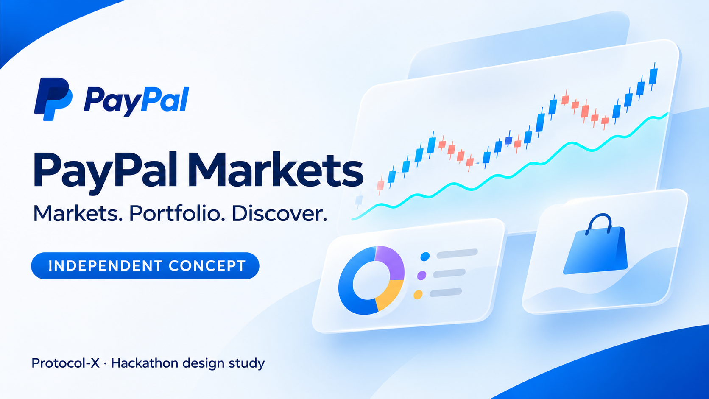

# PayPal Markets

<p align="center">
  <a href="publication-packs/README.md">
    
  </a>
</p>

<p align="center"><strong>INDEPENDENT CONCEPT · HACKATHON DESIGN STUDY</strong></p>
<p align="center">Market clarity · personal planning · everyday discovery</p>
<p align="center">
  <a href="publication-packs/START-HERE.md"><strong>Browse the visual gallery</strong></a>
  &nbsp;·&nbsp;
  <a href="publication-packs/README.md"><strong>Explore the publication pack</strong></a>
  &nbsp;·&nbsp;
  <a href="publication-packs/releases/paypal-markets-CONCEPT-20261108-v8.zip"><strong>Download edition v8</strong></a>
  &nbsp;·&nbsp;
  <a href="publication-packs/releases/paypal-markets-CONCEPT-20261108-v8/README.md">Read its scope and evidence</a>
</p>

> **Independent concept.** This project is not an official PayPal or Venmo product. No affiliation, endorsement or trademark licence is claimed.

PayPal Markets is a public website and companion Expo app for customers who already use Venmo for wallet and payment activity. It adds clear cryptocurrency prices, market context, charts, a device-local manual holdings estimate, and Channel3 product discovery.

## What works in this build

- A public homepage with live CoinGecko market snapshots and a link into the dashboard.
- Live Bitcoin, Ethereum, Solana, Chainlink, Litecoin, Bitcoin Cash, and PayPal USD market metrics from CoinGecko.
- Price history charts for 1 day, 1 week, 1 month, 3 months, and 1 year, with controls to zoom and move through the visible window.
- A choice of 27 display currencies for dashboard and mobile market values, charts, and portfolio estimates. The preference is saved separately on each browser or device.
- A locally stored watchlist and manual crypto quantities. These do not connect to or read from Venmo or another wallet.
- A web Venmo payment draft with a review step. Recipient and USD amount are entered manually; amount formatting preserves the entered cents, and the app only copies the draft when asked. Venmo remains the place to verify the recipient and send a payment.
- Channel3 product search, a shared curated catalog with 14 category shelves, Target/CVS/Walmart/Best Buy retailer filters, retailer offers, price comparison, and device-local named collections. Catalog pages contain up to 24 products, with customer-initiated loading up to 96 results per selection. Current offers show advertised affiliate commission when supplied; this is not customer cashback or a guaranteed payout. Curated sections use verified Channel3 category browsing; searches and category loads happen only after a customer action. Before a retailer handoff, the app rechecks the exact product and asks the customer to choose from the current offers; it requires another check after five minutes. Checkout remains with the retailer. Website images are fetched only from Channel3's image host without credentials or redirects; responses must allow CORS, be a supported raster image, and stay within 4 MiB, or a placeholder is shown.
- PayPal+ is not an active app feature or account connection. Its supplied screens informed the dark visual style only.
- A US-first shopping storefront, with United Kingdom and other supported regions available to choose. The shopping region is saved separately per browser or device and selects the catalog locale and offer currency; it is independent of the portfolio display currency. Changing it clears current offers and retailer checks while preserving saved collections.
- A companion Expo client with Markets, Channel3 Shop and device-local collections, manual Portfolio, a Business report view, and a Venmo note draft. An Android debug build has been installed and opened on a Xiaomi; full physical-device acceptance remains open.
- An Account area for Personal Lite planning and PayPal Business account-holder reports. Business starts empty, offers a clearly labeled synthetic preview, and can read a user-provided aggregate CSV in browser or native app memory. The report compares supplied periods and sales channels for transactions, gross and refunds. The website also offers a separate, opt-in PayPal Activity Download checkout-row preview. Imported reports are unverified and not live; they are not uploaded or saved by the app. PayPal internal management has its own disconnected concept under `apps/management`, with an explicit fictional preview.
- AG Charts metric history and an AG Grid Business view; the Business workspace is empty by default and offers an opt-in synthetic preview labeled as not-live PayPal activity.
- Data settings to export or reset locally saved holdings, the display currency, watchlists, and product collections.
- A standalone web app manifest and layouts tuned for phone screens.
- Local Postman collections for Channel3 product APIs and the app's market endpoints.
- Baseline response headers and an app liveness endpoint for Render health checks.

Tracked assets match the seven cryptocurrencies listed on [PayPal's UK help page](https://www.paypal.com/uk/cshelp/article/what-is-cryptocurrency-help560); eligibility and availability vary by region and account. Market prices are reference data and may differ from prices offered by a payment provider or exchange. PayPal USD (PYUSD) is shown as its own USD-pegged stablecoin; its $1.00 chart reference appears when USD is selected. The public homepage snapshot remains in USD. CoinGecko data is not a PayPal or Venmo execution price, and cached data may be delayed; the displayed retrieval time helps identify its age. The display preference does not change a wallet or payment currency. The app requires a CoinGecko Demo key in `COINGECKO_DEMO_API_KEY` and does not fall back to shared keyless access.

## Start locally

The [current local acceptance record](docs/LOCAL-UPGRADE-ACCEPTANCE-20261106.md) distinguishes implemented source, browser checks, device checks and remaining release gates. The published [PayPal Markets CONCEPT v8 pack](publication-packs/releases/paypal-markets-CONCEPT-20261108-v8/README.md) includes reviewed artwork, historical website imagery, Expo Web captures, fictional Operations previews, and a time-stamped native Android Markets capture. Browse the [GitHub gallery](publication-packs/START-HERE.md), download the [pack ZIP](publication-packs/releases/paypal-markets-CONCEPT-20261108-v8.zip), or open the [publication-pack index](publication-packs/README.md). It does not imply PayPal affiliation, endorsement, or production readiness.

```bash
npm install
cp .env.example .env.local
npm run dev
```

Open `http://localhost:3000` for the public homepage or `http://localhost:3000/dashboard` for the market workspace. A product query such as `/dashboard?q=headphones` opens Discover with the phrase filled in; it does not run the search automatically. Set `CHANNEL3_API_KEY` in `.env.local` to enable product search and curated category browsing. Provider credentials are read only on the server and are not included in the browser bundle. Set `COINGECKO_DEMO_API_KEY` to a CoinGecko Demo key before loading market data.

The root development server binds only to `127.0.0.1`. For a USB-connected Android debug app, use the documented [`adb reverse` workflow](apps/mobile/README.md#usb-connected-android-debug-app); direct Wi-Fi access to this local API is not supported by the default setup.

Website and mobile storefront choices send an explicit locale: US/USD/en or GB/GBP/en. Legacy requests without a storefront use supported `CHANNEL3_LANGUAGE`, `CHANNEL3_COUNTRY`, and `CHANNEL3_CURRENCY` values, defaulting to en/US/USD when unset. Same-origin browser requests work by default. Expo Web development allows only the local `localhost:8081` origins; a hosted Expo Web client must be listed as an exact HTTPS origin in the server-only `MOBILE_WEB_ORIGINS` variable. Cross-origin requests never include credentials. Channel3 search and curated browsing share an eight-request-per-minute process limit keyed by Render's Cloudflare-verified client address when available, falling back to one unknown-address bucket otherwise. Search also permits eight concurrent request-body readers per process; excess requests get a retryable 503. These limits are not shared across instances and do not replace edge connection limits. Native clients can omit `Origin`.

The Business workspace's aggregate importer accepts a bounded, aggregate-only CSV using the [blank template](public/templates/business-aggregate-template.csv). It compares two complete consecutive 7- or 30-day UTC periods with matching broad sales channels and one currency. The browser reads a selected file; the native screen accepts pasted CSV and clears its input and report when leaving Business or choosing Clear. The app does not upload or save the report, though the device keyboard or clipboard may retain a copy. Avoid identifying or very small customer groups. The view shows the source-stated timestamp and never treats transaction counts as unique customers or retention.

Separately, the website can preview a narrow subset of a user-selected [PayPal Activity Download CSV](https://developer.paypal.com/reports/activity-download/). Android and iOS also offer an opt-in copied-text preview; they cannot verify the original file's bytes or that every row was copied, and the clipboard is read before its size can be checked. The user must confirm authorization and that one unsplit export covers both complete 7- or 30-day UTC periods, and select its UK or US date order. The preview accepts only UTC/GMT rows with English status and balance-impact values, requires PayPal's `Transaction Event Code` and `Balance Impact` columns, and rejects malformed, duplicate or unsupported data, inputs over 4 MiB, and more than 50,000 rows. It requires at least one row in each period but cannot independently verify full export coverage. It counts only completed `T0006`/`T0007` credit rows, reports exclusions, and calculates neither amounts nor refunds, unique customers or retention. These are self-provided, unverified report-row counts, not live PayPal data or complete sales. The report can contain names, email addresses and other personal information; the app processes it locally without upload or persistence. The clipboard, browser or operating system may retain copies. Merchant account connections, live monitoring, and alerts remain unconfigured.

Business amounts use a pinned copy of [SIX's ISO 4217 current-currency list](https://www.six-group.com/dam/download/financial-information/data-center/iso-currrency/lists/list-one.xml), published 2026-09-17, for their minor-unit scale. Codes without a numeric minor unit and codes not in that list are rejected, including historical codes; the pinned list must be updated as the standard changes. This report currency is supplied by the report and does not follow the portfolio or shopping preference.

## Postman collections

- `postman/collections/Channel3 Marketplace` covers product search, retailer/brand/category browsing, similar products, product details, URL lookup, and product price history.
- `postman/collections/PayPal Market APIs` covers the local crypto market, display-currency quotes and charts, Channel3 search and curated catalog browse, and service health endpoint.
- `postman/environments/Channel3.environment.yaml` has an empty secret field. Add the Channel3 key locally in Postman; do not commit it. The app's `.env.local` does not automatically populate Postman.

OpenAPI contracts are in `postman/specs/`. These files and collections are local; they have not been pushed to a Postman cloud workspace.

## Local verification

With the development server running on `127.0.0.1:3000`, run the website's currency, chart, portfolio, and CORS checks from the repository root:

```sh
node --test tests/chart-scale.test.mjs tests/currency-contract.test.mjs tests/portfolio-summary.test.mjs tests/market-cors.test.mjs tests/business-snapshot.test.mjs tests/paypal-activity-import.test.mjs tests/channel3-storefront.test.mjs tests/storefront-storage.test.mjs tests/marketplace-safety.test.mjs tests/marketplace-search-capacity.test.mjs
```

`node --test tests/marketplace-search-http.test.mjs` additionally checks saturation and recovery against the local server. It briefly occupies all search body-reader slots and does not call Channel3.

Run the mobile display checks from `apps/mobile`:

```sh
node --test tests/market-display.test.cjs tests/channel3-shop.test.cjs tests/business-snapshot.test.cjs
```

The [local market simulation](postman/simulations/coingecko-currency-regression.md) exercises provider failures and currency responses with synthetic data. Its guide lists the Linux and Postman CLI prerequisites.

## Providers and boundaries

- CoinGecko supplies broad market metrics and historical price series.
- Channel3 supplies product discovery and retailer offers. It does not replace Venmo or process payments; purchases remain with the retailer.
- Customer-saved product lists are app-managed and remain in browser or device storage. The shared curated catalog is app-wide and uses Channel3 browse filters. A calendar-based seasonal edit highlights four categories at a time, keeps all categories available, and fetches current offers and advertised commissions when selected. Curated browsing requires a valid server-only `CHANNEL3_COLLECTION_ID`; missing or malformed configuration returns 503 without an unscoped browse. Explicit text search can omit the collection, while a configured ID scopes it. A new Everyday Discoveries collection was created from the Twitch rules on 2026-11-06 with four additional retailer inclusions; integration verification is recorded separately in the local acceptance report. This does not provide cross-device customer-list sync.
- Venmo remains the customer wallet/payment surface. This prototype does not import wallet balances or initiate crypto trades.
- The legacy agent chat, wallet, and checkout routes are retired. The PayPal webhook verifies deliveries and acknowledges them without crediting balances or issuing payouts. Payment flows should remain disabled until they have authenticated ownership, durable order mapping, and idempotent event processing.
- Zapier MCP onboarding has run in read-only mode with Google Calendar and GitHub; calendar writes, AI payments, subscriptions, and other agent actions remain deferred.
- The public Render demo is live at `https://paypal-markets-companion.onrender.com`. Its latest verified website deployment is `b40086e` (7 November 2026); GitHub `main` is at `ca3bc03`, a gallery-only commit marked `[skip render]`. On 9 November, read-only checks confirmed `/api/health` returns 200 and customer sign-in remains unavailable. See [hosted-state and release evidence](docs/DEPLOYMENT-CANDIDATE-20261106.md). Elastic has a guarded server telemetry scaffold, but live export remains unconfigured and unverified. The separate restricted Kernel agent account is not integrated.

## Render and PayPal webhooks

The webhook callback is `https://paypal-markets-companion.onrender.com/api/webhooks/paypal`. The approved 6 November sandbox test registered a product-created webhook and verified its ID locally and on Render. A fictional sandbox product produced the matching PayPal event, but successful receiver delivery and signature verification remain unconfirmed. See [the deployment evidence](docs/DEPLOYMENT-CANDIDATE-20261106.md) for the tested revision and limits. `/api/health` checks app liveness only. The endpoint verifies and acknowledges valid deliveries without processing payments. The service uses paid Render compute and a separate restricted database for authentication. This does not establish production readiness for webhook processing or customer data; the local filesystem remains ephemeral.

## Commands

```bash
npm run lint
npx tsc --noEmit
```

The Bryntum Scheduler trial bundle is kept outside the app's compile and lint inputs until its license and intended integration are settled. AG Grid Enterprise and AG Charts are installed; set `NEXT_PUBLIC_AG_GRID_LICENSE` for the Business workspace at build time. Because it is a `NEXT_PUBLIC_` value, Next.js includes it in client-side JavaScript: it is visible to browser users and is not a server secret. Handle its distribution according to the AG Grid license terms.
