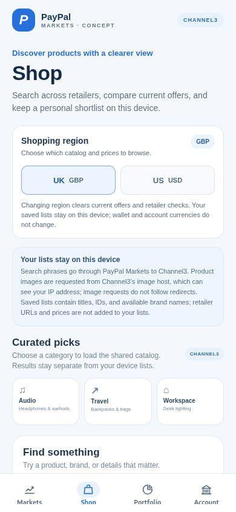
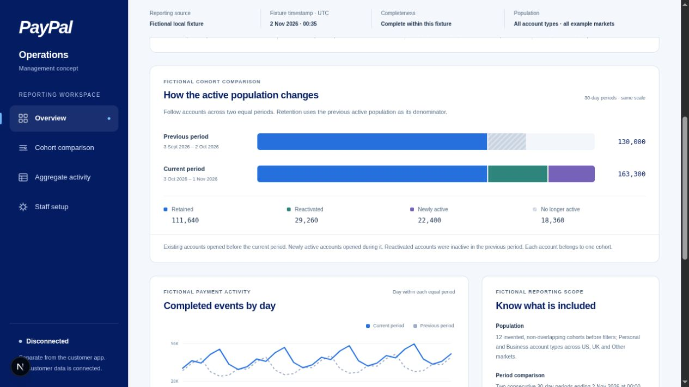

# PayPal Markets — CONCEPT visual catalogue

**Independent concept for PayPal. No official affiliation or endorsement is claimed.** PayPal and Venmo names and marks remain with their owners; this pack does not claim a trademark licence.

This GitHub-rendered gallery makes the edition's visuals and evidence links easy to browse in the repository. The screenshots are historical previews. The separate Operations images use fictional figures.

| Browse in the repository | Download for offline review |
| --- | --- |
| [Open the edition overview](releases/paypal-markets-CONCEPT-20261107-v4/README.md) | [Download the complete v4 ZIP](releases/paypal-markets-CONCEPT-20261107-v4.zip) |
| [Review provenance](releases/paypal-markets-CONCEPT-20261107-v4/PROVENANCE.json) | [Verify the ZIP checksum](releases/paypal-markets-CONCEPT-20261107-v4.zip.sha256) |

GitHub displays `.html` files as source. The local `START-HERE.html` is an offline catalogue: extract the ZIP and open it from inside the extracted edition folder so its relative links resolve.

## Product previews

The phone and tablet captures are Expo Web previews, not native-device acceptance. They are unchanged historical captures from 6 November 2026.

| Personal · phone | Discover · phone |
| --- | --- |
| **Personal account concept**  | **Channel3 discovery concept**  |
| Customer-entered estimates; no connected wallet balance. | UK/GBP discovery controls; no checkout or product offer shown. |

| Business · tablet | Saved shortlist · phone |
| --- | --- |
| **Business workspace concept**  | **Shortlist concept**  |
| Empty example state; no PayPal Business account connected. | Invented empty list; no customer or retailer data. |

## Web and market views

Market and AI captures show a historical public CoinGecko reference snapshot. Values are not current execution quotes, and the commentary is not personalized investment advice.

| Markets homepage | Market insight |
| --- | --- |
| **Historical homepage concept**  | **Historical local insight concept**  |

## Separate Operations concept

These disconnected local presentation previews use invented aggregate and cohort figures. They do not show PayPal internal reporting or customer activity.

| Fictional overview | Fictional charts |
| --- | --- |
| **Operations overview**  | **Operations charts**  |

## Independent concept artwork

These original illustrations are promotional concepts, not product screenshots or an official PayPal/Venmo release.

| Landscape cover | Square social tile |
| --- | --- |
|  |  |

## Evidence and limits

- [Capture review](releases/paypal-markets-CONCEPT-20261107-v4/evidence/CAPTURE-REVIEW-20261107.json) records screenshot hashes, dimensions and review scope.
- [Capture evidence](releases/paypal-markets-CONCEPT-20261107-v4/evidence/CAPTURE-EVIDENCE.json), [market insight evidence](releases/paypal-markets-CONCEPT-20261107-v4/evidence/AI-CAPTURE-EVIDENCE.json) and [artwork provenance](releases/paypal-markets-CONCEPT-20261107-v4/evidence/ARTWORK-PROVENANCE.json) record the sources and limits.
- [Usage and identity guidance](releases/paypal-markets-CONCEPT-20261107-v4/USAGE.md) keeps the CONCEPT disclosure, credits and scope with the pack.
- Live sign-in, connected wallet balances, payments, trading, real Business reporting, internal monitoring, native-device acceptance and production readiness are not established by this edition.

The pack is staged for review. Public publication, external submission and deployment remain separate actions.
