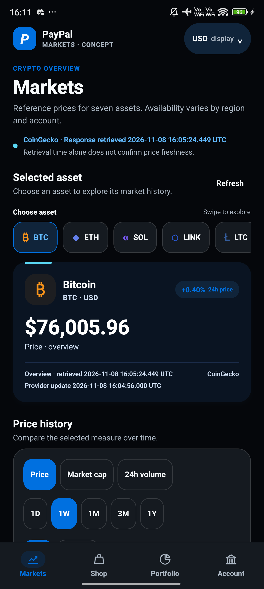
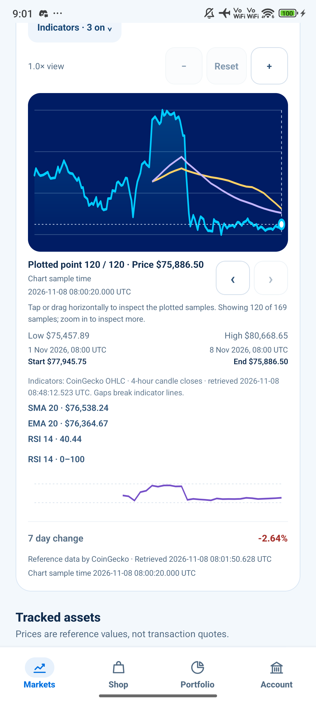
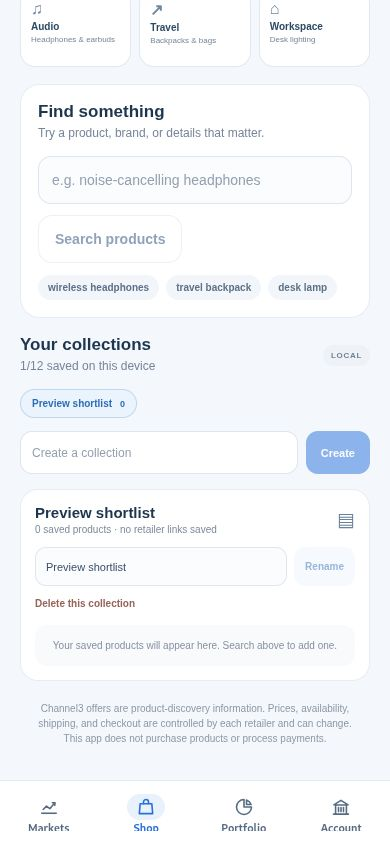
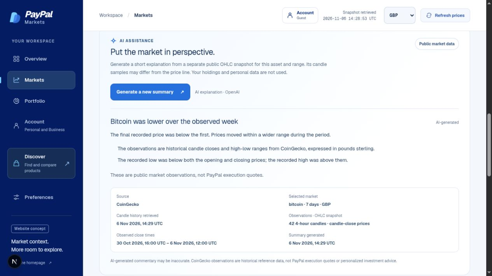
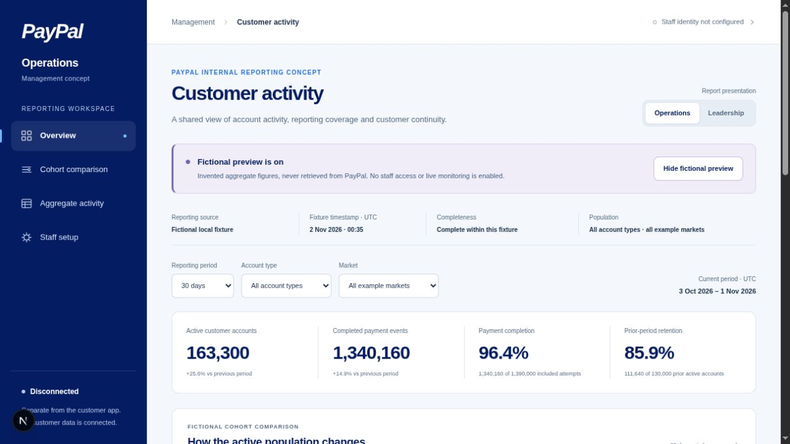

# PayPal Markets — CONCEPT visual gallery

**Independent concept for PayPal. No official affiliation or endorsement is claimed.** PayPal and Venmo names and marks remain with their owners; this pack does not claim a trademark licence.

This GitHub-rendered page presents edition v8. The newest image is a real Xiaomi Android 15 debug-session capture of the dark-mode Markets overview. The earlier website, Expo Web and native screens remain in the gallery as clearly dated **Light-mode** previews.

| Browse in the repository | Download for offline review |
| --- | --- |
| [Open the v8 overview](releases/paypal-markets-CONCEPT-20261108-v8/README.md) | [Download the full v8 ZIP](releases/paypal-markets-CONCEPT-20261108-v8.zip) |
| [Review provenance](releases/paypal-markets-CONCEPT-20261108-v8/PROVENANCE.json) | [Verify the ZIP checksum](releases/paypal-markets-CONCEPT-20261108-v8.zip.sha256) |

GitHub displays `.html` files as source. For the image-rich offline catalogue, download and extract the ZIP, then open `START-HERE.html` inside the extracted edition folder.

## Native Markets · Dark mode

| Xiaomi Android · Markets overview |
| --- |
| **INDEPENDENT CONCEPT — Dark-mode Markets on Xiaomi Android 15**  |

Captured on 8 November 2026 in the installed PayPal Markets 0.1.0 debug app. Updated JavaScript was served over Metro from a dirty review checkout based on `b40086e`; the exact runtime bundle hash was not recorded. This is not a standalone release build. The screen shows a public BTC/USD reference and separate response/provider timestamps; no signed-in account or personal balance is shown. These are point-in-time provider values, not guaranteed-current or PayPal execution prices.

## Native Markets · Historical Light mode

These earlier Xiaomi Android 15 captures are retained for continuity. They show the earlier Light-mode palette and are not examples of the later dark appearance.

| Markets overview · 09:01 UTC | Chart with indicators · 09:01 UTC | Chart after refresh · 09:29 UTC |
| --- | --- | --- |
|  |  |  |

The earlier native app was also a debug build. The chart and overview may have different retrieval times; see the included capture and refresh evidence. Neither screenshot proves standalone release packaging or current hosted behavior.

## Web and responsive previews · Historical Light mode

The following web and Expo Web images were captured on 6 November 2026. They are useful for viewing earlier layout work and do not show the later dark palette. Expo Web is a browser preview, not physical-device acceptance.

| Markets website | Personal · phone-width Expo Web |
| --- | --- |
| **Historical Light-mode homepage**  | **Personal account concept**  |

| Discover · phone-width Expo Web | Business · tablet-width Expo Web | Saved shortlist · phone-width Expo Web |
| --- | --- | --- |
|  |  |  |

## Historical market insight · Light mode

The screenshot shows a local insight based on historical public BTC/GBP candle data. It is not personalized investment advice.

## Separate fictional Operations concept

These disconnected local presentation previews use invented aggregate and cohort figures. They do not show PayPal internal reporting, staff tools or real customer activity.

| Fictional overview | Fictional charts |
| --- | --- |
|  |  |

## Independent concept artwork

These original illustrations are promotional concepts, not product screenshots or an official PayPal/Venmo release.

| Landscape cover | Square social tile |
| --- | --- |
|  |  |

## Evidence and limitations

- [New dark-mode capture record](releases/paypal-markets-CONCEPT-20261108-v8/evidence/NATIVE-ANDROID-DARK-CAPTURE-20261108.json) documents the image hash, visible scope and debug-session limits.
- [Earlier native capture record](releases/paypal-markets-CONCEPT-20261108-v8/evidence/NATIVE-ANDROID-CAPTURE-20261108.json) and [chart-refresh observations](releases/paypal-markets-CONCEPT-20261108-v8/evidence/NATIVE-MARKET-REFRESH-20261108.json) describe the historical Light-mode device session.
- [Capture review](releases/paypal-markets-CONCEPT-20261108-v8/evidence/CAPTURE-REVIEW-20261107.json), [market insight evidence](releases/paypal-markets-CONCEPT-20261108-v8/evidence/AI-CAPTURE-EVIDENCE.json) and [artwork provenance](releases/paypal-markets-CONCEPT-20261108-v8/evidence/ARTWORK-PROVENANCE.json) record remaining source details.
- [Usage and identity guidance](releases/paypal-markets-CONCEPT-20261108-v8/USAGE.md) keeps the concept disclosure, credits and scope with the pack.

The dark-mode proof is limited to one native Markets overview in one local Xiaomi Android 15 debug session. The exact Metro JavaScript bundle hash was not recorded. The web app, Discover, Portfolio, Account, tablet/iOS layouts, standalone release app and hosted behavior were not recaptured as dark-mode evidence here. No live sign-in, connected balances, payment, trade, live Business reporting, internal PayPal monitoring or production readiness is established.
