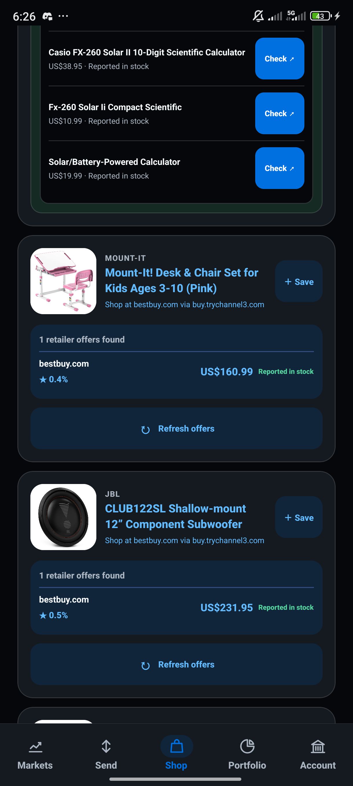
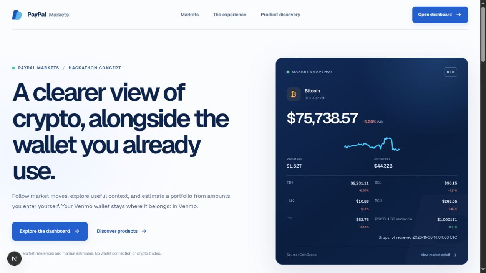
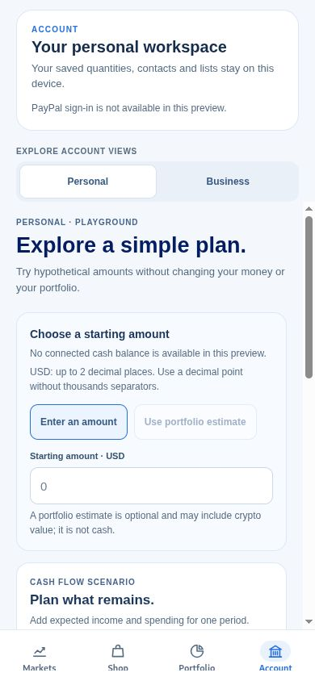
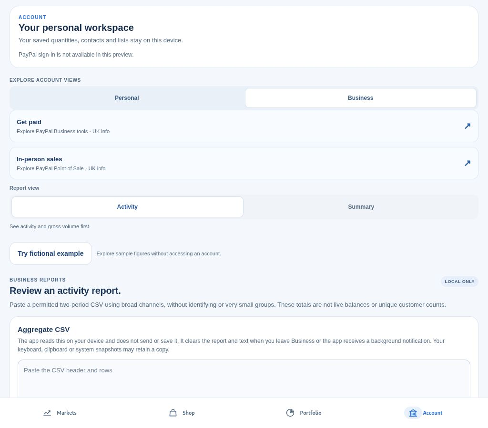
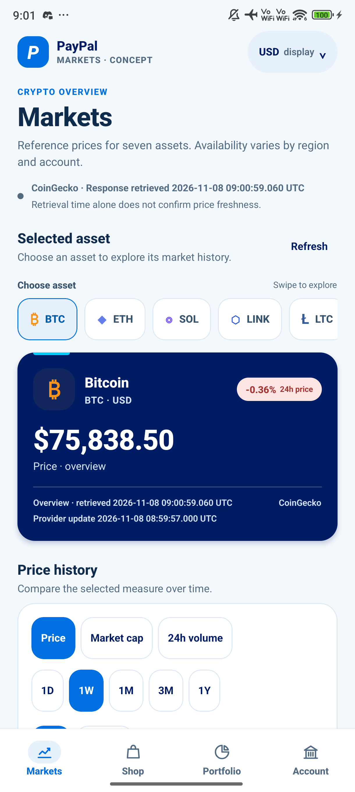
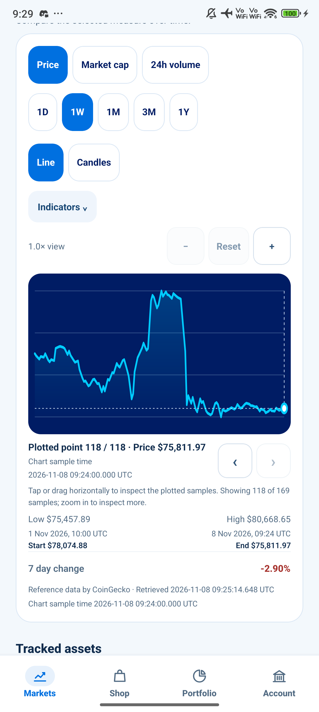

# PayPal Markets — Visual gallery

**Independent concept for PayPal. No official affiliation, endorsement or trademark licence is claimed.** PayPal, Venmo and retailer marks remain with their owners.

A dark market companion and US-first discovery concept, with visible retailer prices and dated evidence. Product prices, reported stock and advertised commission rates can change; screenshots show only what was displayed at their capture time.

| Browse in GitHub | Download and review offline |
| --- | --- |
| [Open the v9 pack notes](releases/paypal-markets-CONCEPT-20261111-v9/README.md) | [Download the complete v9 ZIP](releases/paypal-markets-CONCEPT-20261111-v9.zip) |
| [Review v9 provenance](releases/paypal-markets-CONCEPT-20261111-v9/PROVENANCE.json) | [Verify the ZIP checksum](releases/paypal-markets-CONCEPT-20261111-v9.zip.sha256) |

GitHub displays `.html` as source. For the visual catalogue, download and extract the ZIP, then open `START-HERE.html` inside the extracted folder.

## Dark-mode native app screens

The 8 November Markets overview and 10 November Shop screen were captured on a Xiaomi Android 15 phone. The Shop image visibly shows USD prices, Channel3-reported stock, star-marked advertised commission rates and retailer actions. Its prices and stock labels are historical snapshots, not current retailer confirmation.

  
  &nbsp;&nbsp;
  

| Markets overview · 8 Nov | Shop offers · 10 Nov |
| --- | --- |
| Public CoinGecko reference values; debug-session capture, not a standalone release. [Evidence](releases/paypal-markets-CONCEPT-20261111-v9/evidence/NATIVE-ANDROID-DARK-CAPTURE-20261108.json) | USD prices and offer details shown at capture time only. [Evidence](releases/paypal-markets-CONCEPT-20261111-v9/evidence/NATIVE-SHOP-CAPTURE-20261110.json) |

## US-first web Shop review · 11 Nov

A local browser review showed **United States · USD**, a maximum-price filter of **$150**, and 24 product results with visible card prices. The written review is included; no current browser screenshot was saved into the pack. One generic/global retailer domain remained in results, so the selected storefront does not guarantee domestic shipping. [Read the review record](releases/paypal-markets-CONCEPT-20261111-v9/evidence/SHOP-REVIEW-20261111.json).

The selected shopping storefront is separate from the portfolio display-currency preference. A retailer’s PayPal policy badge is not proof that a particular seller, item or order will accept PayPal.

## Historical Light-mode previews

These earlier website, Expo Web and native Android screens are kept for continuity. They do not show the later dark styling. Expo Web is a responsive browser preview, not physical-device evidence.

| Markets website | Personal account · phone-width Expo Web |
| --- | --- |
|  |  |

| Discover · phone-width Expo Web | Business · tablet-width Expo Web | Saved shortlist · phone-width Expo Web |
| --- | --- | --- |
|  |  |  |

| Native Markets overview · Light mode | Native chart with indicators · Light mode | Native chart after refresh · Light mode |
| --- | --- | --- |
|  |  |  |

## Separate fictional Operations concept

These disconnected previews use invented aggregate values. They do not show PayPal internal reporting, staff tools or real customer activity.

| Fictional overview | Fictional charts |
| --- | --- |
|  |  |

## Independent concept artwork

New dark landscape and square artwork were generated for v9. These are illustrations, not product screenshots or an official PayPal/Venmo release.

| Landscape cover | Square social tile |
| --- | --- |
|  |  |

## Capability and evidence boundaries

- Live merchant checkout, an agent-controlled spendable wallet, PYUSD transactions and subscription actions are not demonstrated.
- Channel3 listed its Checkout API as coming soon when checked on 11 November 2026. Product discovery and retailer handoff do not prove in-app payment. [Channel3 developer page](https://www.trychannel3.com/developers/).
- The Xiaomi Android captures are debug-session screens; the standalone Android update and app launch remain unverified.
- Market references, saved estimates and AI commentary are not PayPal execution pricing or financial advice.
- [Asset index](releases/paypal-markets-CONCEPT-20261111-v9/ASSET-INDEX.json), [capture evidence](releases/paypal-markets-CONCEPT-20261111-v9/evidence/), [artwork provenance](releases/paypal-markets-CONCEPT-20261111-v9/evidence/ARTWORK-PROVENANCE.json), and [submission checklist](releases/paypal-markets-CONCEPT-20261111-v9/copy/SUBMISSION-CHECKLIST.md) are included.
- [Edition v8](releases/paypal-markets-CONCEPT-20261108-v8/README.md) is preserved unchanged as the previous gallery pack.
