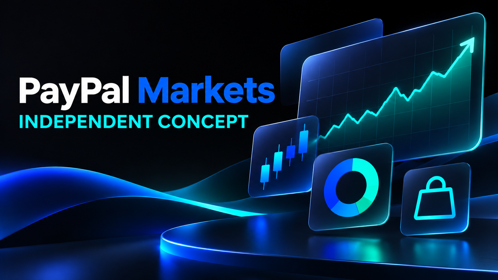

# PayPal Markets — CONCEPT edition v9

**Independent concept for PayPal Markets. No official affiliation, endorsement or trademark licence is claimed.** PayPal, Venmo and retailer identities remain with their owners.

This edition brings the dark market look into the Shop story: visible USD prices, retailer context and starred advertised commission rates. It pairs dated Android screens with an honest local web review and keeps each screen tied to its actual capture date and surface.

## Browse this edition

- [Open the offline visual catalogue](START-HERE.html) after downloading and extracting the ZIP.
- [Download the complete v9 pack](../paypal-markets-CONCEPT-20261111-v9.zip).
- [Verify the archive checksum](../paypal-markets-CONCEPT-20261111-v9.zip.sha256).
- [Review asset hashes and capture metadata](ASSET-INDEX.json).
- [Review provenance and evidence boundaries](PROVENANCE.json).
- [Read usage and credit notes](USAGE.md).

## What the captures show

- **Dark-mode Markets:** Xiaomi Android 15 screen captured on 8 November, showing public CoinGecko reference data. It is from a debug session; it does not establish a standalone release.
- **Dark-mode Shop:** Xiaomi Android 15 screen captured on 10 November. Product images, USD prices, Channel3-reported stock, star-marked advertised rates and retailer actions are visible. Its offer values are historical and do not confirm current retailer inventory.
- **US-first website Shop:** local browser review on 11 November showed United States · USD, a $150 maximum price filter and 24 results with visible card prices. The review is a written observation; no current browser screenshot was saved in this pack. One generic/global retailer domain appeared, so the storefront does not guarantee domestic shipping.
- **Earlier Light-mode previews:** website, responsive phone/tablet and earlier native views remain dated historical references.
- **Operations:** examples are fictional and disconnected from PayPal internal systems.

## Payment and agent-wallet boundary

This pack does not demonstrate live merchant checkout, customer wallet access, an agent-controlled spendable wallet, a PYUSD payment, subscription management or a completed purchase. Channel3's developer page listed its checkout API as coming soon when checked on 11 November 2026. A testnet wallet flow may demonstrate broader agent experience, but test tokens have no monetary value and are not live payment evidence.

Market prices, stock reports and affiliate rates can change. They are point-in-time references, not PayPal execution prices or guaranteed retailer inventory. Nothing here is investment advice or a claim of production readiness.

## Integrity

`SHA256SUMS.txt` covers the pack files except itself. The adjacent ZIP checksum covers the archive. `ASSET-INDEX.json` records copied asset hashes; `PROVENANCE.json` records review scope and source-file hashes without including application source.
